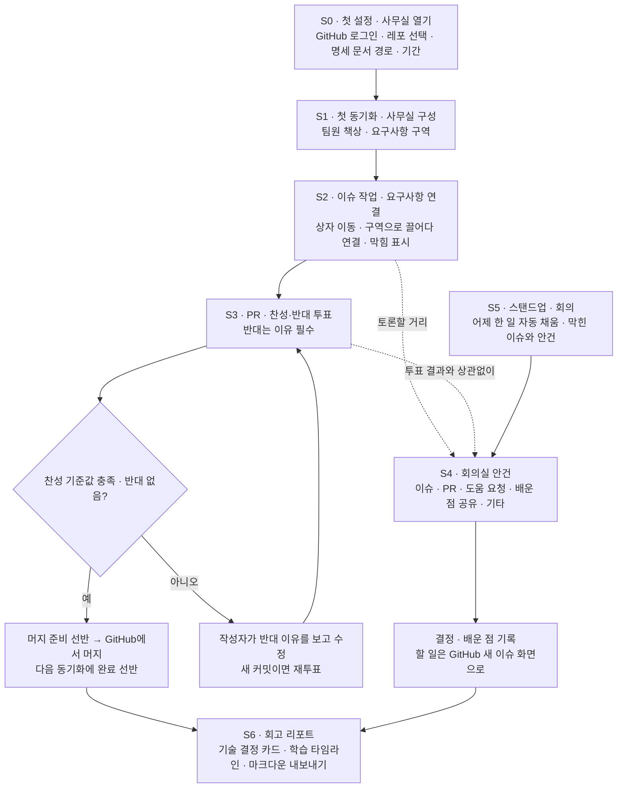

# 업무 분석 — 팀 오피스 v1

> 문서: 02-workflow.md · 상태: 초안 · 열린 질문 [?] 0개 · 채택한 [제안] 0개(S3 투표 · S4 회의실 안건은 제안 요구사항 FR-LRN에 기대 — requirements-changes.md 상태 "검토 중") · 마지막 갱신: 2026-10-28
> 이 문서를 읽는 에이전트에게: 여기 없는 것은 지어내지 말고 질문으로 돌려라.
> 이 문서는 MVP 기준 핵심 사용자 흐름만 다룬다. 단계는 기획안 「사용자와 역할」 대표 시나리오 1~6과 「배움의 흐름」을 따른다. 행위자 ID는 정의서의 ROLE-01~03이다.

---

## 행위자

| A  | 이름    | 역할                          | 한 줄 상황                                                                                                                                        | 지금 쓰는 도구              |
| -- | ----- | --------------------------- | --------------------------------------------------------------------------------------------------------------------------------------------- | --------------------- |
| ROLE-01 | 참여자 (팀원) | 팀 레포 write 권한 | 2주 부캠 팀 프로젝트에서 막혔을 때 빨리 드러나고, 내 작업을 회고 리포트와 면접 준비로 남기고 싶다 | GitHub (이슈 · PR · 코멘트) |
| ROLE-02 | 레포 관리자 (팀장) | 팀 레포 admin 권한 | 요구사항 진행률과 막힘을 한눈에 보고 회의를 진행하고 싶다. 레포 주인으로서 레포 등록(사무실 열기)과 팀 설정을 맡는다 | GitHub (이슈 · PR 목록) |
| ROLE-03 | 전체 관리자 (1명) | 서버 설정에서 지정 | 사무실 관리 권한과 사용자·권한 관리를 맡는다 | TODO: 대응 내용 없음 (기획안에 서술 없음) |

> 검토했으나 제외한 후보, 문서 정리 이력, 이전 본문 주석은 [00-backlog.md](00-backlog.md)에 모아뒀다.

---

## 단계 (As-Is → To-Be)

| S  | 단계                      | 행동(As-Is)                                                    | 감정                                           | 불편                                                                              | To-Be 한 줄                                                                                                              |
| -- | ----------------------- | ------------------------------------------------------------ | -------------------------------------------- | ------------------------------------------------------------------------------- | ---------------------------------------------------------------------------------------------------------------------- |
| S0 | 첫 설정 · 사무실 열기 | 팀장이 GitHub에 팀 레포를 만들고 명세 문서와 이슈를 따로 관리한다 | TODO: 대응 내용 없음 (기획안에 서술 없음) | 명세 문서의 요구사항과 실제 이슈·PR이 연결되지 않아, 빠진 요구사항이 마감 직전에 발견된다 | 팀장이 GitHub로 로그인해 우리 조 레포를 고르고, 명세 문서 경로와 프로젝트 기간을 넣는다. 여기까지 **5분 안에** 끝난다 · NFR-01, FR-AUTH-01, FR-GH-01, FR-REQ-01, FR-PLAN-01. 팀원은 열린 사무실에 처음 들어올 때 활동 기록 수집 동의만 거친다 |
| S1 | 첫 동기화 · 사무실 구성 | 누가 리뷰를 기다리는지, 어떤 이슈가 멈췄는지 GitHub 목록을 하나씩 열어본다 | 요구사항 진행률과 막힘을 한눈에 보고 싶다(ROLE-02) | 목록을 하나씩 열어봐야 알 수 있다 | 첫 동기화가 끝나면 사무실에 팀원 수만큼 책상이 생기고, 명세 문서의 ## 제목마다 바닥 구역이 생긴다 · FR-OFF-01, FR-REQ-02. 이후 변경분은 폴링으로 가져온다 · FR-GH-03 |
| S2 | 이슈 작업 · 요구사항 연결 | 이슈를 만들고 담당자를 지정해 작업한다 | 막혔을 때 빨리 드러나고 싶다(ROLE-01) | 막힘이 하루만 방치돼도 2주 일정이 무너진다 | 이슈 상자가 상태에 따라 백로그 선반, 담당자 책상, 검토, 완료 선반으로 옮겨지고, 팀장은 연결 안 된 상자를 구역으로 끌어다 놓는다 · FR-OFF-02, FR-REQ-04. 기준 시간을 넘긴 작업은 이유 문구와 함께 막힘으로 표시된다 · FR-FLOW-01, FR-FLOW-02 |
| S3 | PR · 찬성·반대 투표 · 머지 | PR을 올리고 GitHub 코멘트로 리뷰를 주고받는다 | TODO: 대응 내용 없음 (기획안에 서술 없음) | PR이나 이슈에 대한 의견이 GitHub 코멘트 안에 묻혀, 팀이 함께 짚고 넘어가며 배울 자리가 없다 | PR이 올라오면 팀원들이 삼각기둥을 눌러 찬성·반대를 남기고(반대는 이유 필수), 찬성이 모인 PR은 머지 준비 선반으로 간다. 머지는 GitHub에서 한다. 투표가 오래 없으면 막힘 표시가 뜬다 · [제안] FR-LRN-01~03, FR-LRN-07 |
| S4 | 회의실 안건 · 토론 | 의견이 GitHub 코멘트에 흩어지고, 도움 요청은 따로 말해야 한다 | TODO: 대응 내용 없음 (기획안에 서술 없음) | 팀이 함께 짚고 넘어가며 배울 자리가 없다 | 함께 토론할 거리가 보이면 PR, 이슈, 도움 요청, 배운 점 공유, 기타 무엇이든 누구나 회의실 안건으로 올린다(투표 · 승인 · 개수 제한 없음). 회의에서 결정과 배운 점을 남기고, 할 일은 GitHub 새 이슈 화면으로 넘긴다 · [제안] FR-LRN-04, FR-LRN-10~12, FR-LRN-14 |
| S5 | 스탠드업 · 회의 | TODO: 대응 내용 없음 (기획안에 As-Is 서술 없음) | TODO: 대응 내용 없음 (기획안에 서술 없음) | TODO: 대응 내용 없음 (기획안에 서술 없음) | 매일 아침 팀원이 스탠드업을 남기면 "어제 한 일"이 GitHub 활동으로 미리 채워지고, 회의실에서 막힌 이슈와 팀원들이 올린 안건을 다룬다 · FR-MTG-01~04 |
| S6 | 회고 리포트 | 프로젝트가 끝나면 배운 것이 이슈와 PR에 흩어진 채 면접 직전까지 정리되지 않는다 | 내 작업을 회고 리포트와 면접 준비로 남기고 싶다(ROLE-01) | 회고 문화가 없어서(ASM-06) 내가 내린 기술 결정과 그 이유를 면접에서 깊이 설명하기 어렵다. 기획, 자료조사, 발표 준비처럼 코드로 남지 않는 기여는 GitHub에 기록되지 않는다 | 프로젝트가 끝나면 각자 회고 리포트를 만들고, 리포트의 기술 결정 카드와 학습 타임라인을 다듬어 마크다운으로 블로그에 올린다 · FR-REP-01~03, [제안] FR-REP-07, FR-LRN-08 |

---

## 흐름

> 이 흐름도는 단계(S) 사이의 흐름만 그린다. 화면 사이의 이동은 07-screens.md 흐름표를 따른다. 스탠드업(S5)은 매일 반복되는 단계라 S2~S4와 나란히 진행된다.

---

## 최종 워크플로우 한 줄

**팀장이 팀 레포를 사무실로 열면 팀 레포가 3D 사무실이 되어, 이슈와 PR이 상태에 따라 사무실 안을 옮겨 다니고 막힘은 이유와 함께 먼저 드러나며, 팀원들은 PR에 찬성·반대를 남기고 무엇이든 회의실 안건으로 올려 함께 토론하며 배우고, 프로젝트가 끝나면 그 과정이 면접에서 쓸 수 있는 회고 리포트로 남는다.**
